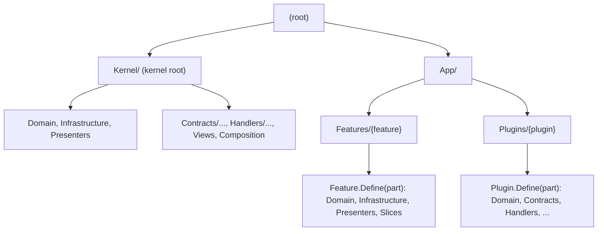

# PR #20 on Umpire preview.24: where the CliCommand layer goes

**Summary.** Main moved the package to `com.umpire.unity` and Umpire 0.2.0-preview.24 (PR #82). PR #20 (test suite) is on preview.11 and has conflicts with main. A merge gives 10 compile errors. Two are in the pack definition: preview.24 removed the `DefinePlugin` and `DefineFeature` hooks. This file gives the old code, a wrong first proposal, the proposal from the template source, and the questions for the template.

Source: tag `v0.2.0-preview.24` of vsa-template. No code is changed in PR #20 yet.

## The compile errors after the merge

| Error | Files | Fix |
|---|---|---|
| CS0507: `Configure` is `protected` now | 7 feature modules, `SessionPlugin` | Change `public override` to `protected override` |
| CS0115: no `DefinePlugin(PartGroup)` or `DefineFeature(PartGroup)` | `TestSuiteArchitecture.cs` | See below |

The text conflicts (`Packages/manifest.json`, `README.md`) are mechanical: keep `com.umpire.unity` from main and the test suite entries from PR #20.

## Before: preview.11

```csharp
public sealed class TestSuiteArchitecture : VsaArchitecture
{
    protected override void DefinePlugin(PartGroup plugin)
    {
        base.DefinePlugin(plugin);
        plugin.Add<CliCommand>();
    }

    protected override void DefineFeature(PartGroup feature)
    {
        base.DefineFeature(feature);
        feature.Add<CliCommand>();
    }

    protected override void Rules(RuleBook rules)
    {
        base.Rules(rules);
        rules.For<CliCommand>().Uses<Contracts>().And<Contracts.Requests>().And<Infrastructure>()
            .And<Domain.Shared>();
    }
}

public record CliCommand : Layer;
```

Result: each plugin and each feature has a `CliCommand` folder.

## First proposal: wrong

```csharp
protected override void Define(Part root, Part kernel)
{
    kernel.Add<CliCommand>();   // WRONG
}
```

I thought that `kernel` is the part set of each module. The template source shows that it is not.

## What the kernel is in preview.24



| Fact | Source |
|---|---|
| The compiler makes one `Kernel` folder under the root and gives it to `Define` as `kernel` | `architecture/Rules/Compiler.cs:14-18`, `Part.AddKernelRoot()` in `architecture/Parts/Part.cs:91-95` |
| If the kernel has no children, the compiler removes it | `Compiler.cs:16-18` |
| The kernel root is a DLL place, like a block place | `architecture/Queries/PartOf.cs:18` |
| Each module concept defines its own parts in `Define(Part part)` | `packs/Vsa/Definition/Concepts/Feature.cs`, `Plugin.cs` |
| The engine calls `Define` and `Rules` at each class level (`Levels.Call`), so an override does not call `base` | `architecture/Architecture.cs:9-22`; the dice sample on main leaves out `base.Rules` |

So `kernel.Add<CliCommand>()` makes one `Kernel/CliCommand` folder. It does not add `CliCommand` to the modules. The kernel is not directed at the modules.

## Proposal from the source: an overlay on the module groups

`PartFind` (`architecture/Parts/PartFind.cs`) finds the placed parts of a concept and adds to them:

```csharp
public sealed class TestSuiteArchitecture : VsaArchitecture
{
    protected override void Define(Part root, Part kernel)
    {
        root.For<Feature>().Add<CliCommand>();
        root.For<Plugin>().Add<CliCommand>();
    }

    protected override void Rules(RuleBook rules)
    {
        rules.For<CliCommand>().Uses<Contracts>().And<Contracts.Requests>().And<Infrastructure>()
            .And<Domain.Shared>();
    }
}
```

- `For<T>().Add<U>()` adds `U` to each placed `T` as an overlay.
- If no `T` is placed, it throws: "finds no placed ... Place it first". So `VsaArchitecture.Define` must run before this level. That is the order of `Levels.Call` if it calls the base level first. Not checked.
- `For<T>().ExtendedBy<TBlock>()` is the other form. It adds a block body with its own `DefinePart` and `Rules` to each placed `T`. The template tests use it (`tests/Architecture.Tests/PartFindTests.cs`). It is a better fit if `CliCommand` becomes a reusable unit with its own rules.

Not checked: a compile and an engine run with this definition. The engine does not run on Unity (tpl#230).

## Questions for the template

1. Is `root.For<Feature>().Add<CliCommand>()` the intended way for a pack to add a layer to each module of a base pack?
2. `For<T>().Add<U>()` or `For<T>().ExtendedBy<TBlock>()`: which one does the template recommend for a layer with its own use rules?
3. Does `Levels.Call` call `Define` from the base level down, so that the `Feature` and `Plugin` groups exist when the derived level runs?
4. What is the kernel for a consumer pack? Is `kernel.Add<X>()` only for shared code in `Kernel/`? A short doc line on `Define(Part root, Part kernel)` can prevent the mistake in the first proposal.
5. preview.24 sets `config.Roots.Add<App>("App")`. The test suite has its modules in `Spike/Features` and `Spike/Plugins`, not under `App/`. Is the root folder name required, or can a pack or a consumer change it?

## Answers from the template (Run Orchestrator, vsa-template main 76ffce04)

| # | Answer | Source |
|---|---|---|
| 1 | Yes. The overlay is the documented way. Leave out `base.Define` and `base.Rules`. | docs/pack-variants.md:94-104, docs/architecture-engine.md:149-157 |
| 2 | Use `Add` plus the rule in `Rules` for one layer in one architecture. Use `ExtendedBy` only to reuse the layer in more than one architecture. | docs/architecture-engine.md:168-196 |
| 3 | Yes. `Levels.Call` runs from the base level down, so the `Feature` and `Plugin` groups exist. | architecture/Concepts/Levels.cs |
| 4 | `kernel` is only the `Kernel/` folder (framework layers, bound as a DLL). It is not a module part set. | docs/architecture-engine.md:112, docs/blocks.md:32 |
| 5 | Not required. `config.Roots.Add<App>("Spike")` in `Configure` makes the App root `Spike/`. Not tested with an engine run. | architecture/Roots.cs |

### Addition from the template

- One line covers features and plugins: `root.For<Module>().Add<CliCommand>();`. `Feature` and `Plugin` derive from `Module`, and `PartFind` matches derived concepts. Not compiled yet.
- The `kernel.Add<X>()` mistake comes from a doc gap: vsa-template#352.
- A renamed App root (`Roots.Add<App>("Spike")`) has no test in the template: vsa-template#355. If we keep `Spike/`, the template wants the result of our first engine run.
