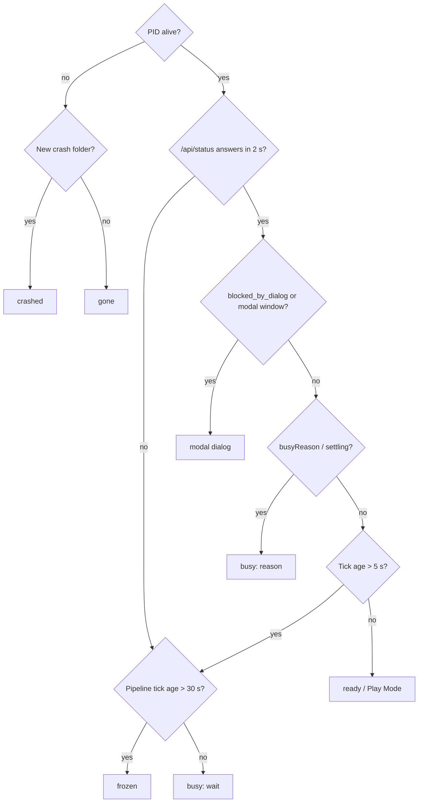

# Prior art: how tools find the true Unity Editor state

Summary: the reliable tools all use a main-thread tick stamp that a background thread reads. They use the process ID for "gone" and a Win32 window scan for "dialog". No examined tool reads a crash folder, and CI tools use only the exit code and an outer job time-out.

## Technique table

| Technique | Tools | Strength | Weakness |
|---|---|---|---|
| Main-thread tick, read off-thread | CoplayDev PR #1350, unity-cli-loop | Separates frozen from gone | Needs Editor code |
| Status file with `last_heartbeat` | CoplayDev, com.unity.pipeline | Readable without a socket | Off-thread writer hides freezes |
| Request with short time-out | Rider (2 s), CoderGamester, unity CLI | No Editor code | Busy and frozen look the same |
| Win32 modal window scan | CoplayDev #1350, Ivan CLI, unity-cli-loop | Names dialog and buttons | Windows only; `GetWindowText` can block |
| PID from file plus process check | Rider, Ivan, unity-cli-loop | Detects "gone" in milliseconds | Stale file after a crash |
| Process exit code plus log | game-ci, Ivan headless | Simple, sure | Only after exit |
| Outer time-out | all | Never waits forever | Gives no reason |

## Per tool

CoplayDev/unity-mcp (= justinpbarnett/unity-mcp) · status file and tick stamp

`github.com/justinpbarnett/unity-mcp` is the same repository (GitHub redirects to CoplayDev).

1. Signals:
   - The status file `~/.unity-mcp/unity-mcp-status-<hash>.json`. The dir can change with `UNITY_MCP_STATUS_DIR`.
   - A TCP or WebSocket ping.
   - `get_editor_state`. Source: `MCPForUnity/Editor/Services/Transport/Transports/StdioBridgeHost.cs`.
2. Busy compared to hung:
   - `ProcessCommands` runs on `EditorApplication.update`. It writes the file every 0.5 s: `nextHeartbeatAt = now + 0.5f;`. Thus a stale file means a stopped main thread.
   - `StdioBridgeReloadHandler.cs` writes `reloading=true` on `beforeAssemblyReload`.
   - `EditorStateCache.cs` uses `compilationStarted/Finished`, `before/afterAssemblyReload` and `playModeStateChanged`.
   - `GetActualIsCompiling()` does not trust `EditorApplication.isCompiling`. That value stays true while a reload is deferred (issues #549, #1276).
3. Limits:
   - `Server/src/services/resources/editor_state.py`: `is_stale = age_ms > 2000`. It gives `blocking_reasons` (`compiling`, `domain_reload`, `running_tests`, `asset_refresh`, `stale_status`) and `recommended_retry_after_ms: 500`.
   - `port_discovery.py` keeps a reloading instance: `if is_reloading and age_s < 60`.
   - `refresh_unity.py` waits 60 s, then reports a time-out.
   - `plugin_hub.py`: `PING_INTERVAL = 10`, `PING_TIMEOUT = 20`, `COMMAND_TIMEOUT = 30`.
4. Crash or exit: the bridge deletes the status file on `quitting`. No crash folder check.
5. File fields: `unity_port`, `reloading`, `reason` (`starting`, `ready`, `reloading`, `port_busy`, `start_failed`), `seq`, `project_path`, `unity_version` and `last_heartbeat` (UTC ISO).

PR #1350 is open, not merged: https://github.com/CoplayDev/unity-mcp/pull/1350

- `MainThreadHeartbeat.cs`: `EditorApplication.update += Beat;` with `Interlocked.Exchange(ref _lastTickMs, Clock.ElapsedMilliseconds);`.
- The `liveness` command is answered on the receive thread. It returns `main_thread_stall_ms`, `main_thread_ticks`, `pending_commands`, `sample_age_ms` and `modal`.
- `EditorLivenessProbe.cs`: a sampler thread runs every 500 ms. It scans windows only when `StallMs >= 1000`.
- The PR body says the scan must stay off the request path: "an unguarded read hung the probe for 10s".
- Modal test: the owner window is disabled. `#32770` dialogs are answerable. `UnityContainerWndClass` (`ShowModal`) is title only.
- Server: `MAIN_THREAD_STALL_THRESHOLD_MS = 1500` and `LIVENESS_TIMEOUT = 2.0`. Hints are `answer_dialog`, `user_action_required` or `wait`. `wait_for_editor_ready` stops at once on a modal dialog.

hatayama/unity-cli-loop (uloop) · best state model

1. Signals:
   - IPC (named pipe on Windows).
   - A main-thread tick.
   - `Temp/UnityLockfile`.
   - Editor.log.
   - A Win32 dialog scan.
2. Busy compared to hung:
   - `EditorMainThreadLivenessTracker.cs` stamps on `EditorApplication.update` and on internal `EditorApplication.tick`.
   - Before it reports "blocked", it calls `EditorApplication.SignalTick()`. This wakes an idle Editor without focus.
   - States: `BlockedByDialog`, `Busy`, `Starting`, `MainThreadBlocked` (5 s or more), `Compiling`, `ImportingAssets`, `Ready`, `NotResponding` (5 s), `ServerUnavailable`, `NotRunning` and `Unreachable`. Source: `.claude/skills/uloop-status/SKILL.md`.
3. Limits:
   - `MainThreadEntryWatchdog.cs`: `BlockedStallSeconds = 30`. A command that did not start is cancelled after 30 s.
   - PR #1312: the server sends a heartbeat frame every 10 s with the stall time. The CLI shows the stall after 30 s and fails after 5 min (`UNITY_EDITOR_UNRESPONSIVE`).
   - If no frames arrive for 60 s, the CLI fails.
   - It retries the connection for up to 60 s while the Unity process for the project is alive.
   - Server restart backoff is 5/15/30 s.
4. Exit:
   - `NotRunning` means no Unity process for the project.
   - On Windows, a lockfile delete that fails with `ERROR_SHARING_VIOLATION` means an Editor holds it (`launch_lockfile_probe_windows.go`).
5. Status reply: `IsPlaying`, `IsPaused`, `IsCompiling`, `IsUpdating`, `SecondsSinceLastMainThreadTick`, `RunningToolName` and `Dialogs`.

IvanMurzak/Unity-MCP CLI · process, lockfile, dialog scan

1. Signals:
   - `Get-CimInstance Win32_Process` filtered on `Unity.exe` and `-projectPath`. Asset import workers are skipped (`cli/src/utils/unity-process.ts`).
   - `Temp/UnityLockfile`, read as a little-endian uint32 PID (`unity-shutdown.ts`).
   - An HTTP ping (`probe.ts`).
   - A PowerShell `EnumWindows` dialog scan (`editor-dialogs.ts`).
2. Busy compared to hung:
   - No tick stamp.
   - During a reload, it retries HTTP 500/502/503/504 (`lib/compile.ts`).
   - After a time-out, busy or unreachable result, it scans for dialogs and exits 18 `AWAITING_INPUT` (`awaiting-input.ts`).
3. Limits:
   - Compile: `DEFAULT_COMPILE_TIMEOUT_MS = 180_000`, poll 1 s, call time-out 30 s.
   - Close: a polite `WM_CLOSE`, a dialog scan every 5 s, then `taskkill /F` at 30 s.
4. Exit: a headless Editor logs to `Logs/unity-mcp-cli-editor.log`. On exit the CLI quotes the compile errors from that log (`lib/ensure-editor.ts`).
5. The Editor writes no status file. Exit codes: 7 unreachable, 14 time-out, 18 dialog.

CoderGamester/mcp-unity · WebSocket ping only

1. Signals: WebSocket on port 8090, WebSocket ping and pong, and close codes. Source: `Server~/src/unity/unityConnection.ts`.
2. Busy compared to hung:
   - No main-thread signal. websocket-sharp sends the pong from a pool thread, so a frozen main thread still answers.
   - Unity closes with code `4001` (`PLAY_MODE`) on Play Mode entry. The client then polls every 3 s.
   - `McpUnityServer.cs` stops the server on `beforeAssemblyReload`.
3. Limits: heartbeat 30 s, pong time-out 5 s, reconnect 1 to 30 s ×2, 50 tries maximum, request time-out from settings.
4. Exit: only a socket close. 5. Nothing is written to a file.

JetBrains Rider Unity plugin · 2 s poll

- `BackendUnityHost.cs` calls `GetUnityEditorState` each 1 s. If there is no reply in 2 s, the state is `Disconnected`.
- Unity side (`unity/EditorPlugin/Protocol/UnityEditorProtocol.cs`): `if (EditorApplication.isCompiling || EditorApplication.isUpdating) return UnityEditorState.Refresh;`. The other states are Play, Pause and Idle.
- Gone: it reads `Library/EditorInstance.json` (`process_id`, `version`), then `ProcessHandle.of(pid).isEmpty` gives `Outdated` (`EditorInstanceJson.kt`).
- Rider has no separate "frozen" state. A freeze shows as `Disconnected`.

Unity CLI and com.unity.pipeline · heartbeat on a server thread

- The descriptor is `Library/Pipeline/.unity-pipeline-port`, with `pid`, `port`, `startedAt`, `lastHeartbeat` and `evalToken`. Source: https://docs.unity3d.com/Packages/com.unity.pipeline@0.4/manual/connectivity.html
- CLI 1.0.0-beta.15: a dialog shows as `starting`, "or `unreachable` once nothing has asked about it for 60 seconds". From 6000.7 it shows `STATUS_BLOCKED_BY_DIALOG`. Source: https://docs.unity.com/en-us/unity-cli/release-notes/2026/october.md
- 1.0.0-beta.14: the CLI shows the busy reason (for example `Compiling scripts.`) instead of a bare 503. A dialog rejection fails at once.
- 1.0.0-beta.15: the CLI reads `Temp/UnityLockfile` and `Library/EditorInstance.json`.
- 1.0.0: "`unity command` says the Editor exited, and may have crashed".
- Local field notes (`~/.claude/skills/unity-field-notes/SKILL.md`):
  - `lastHeartbeat` moves every 15 s on another thread, also during a main-thread freeze.
  - `/api/status` stays `ready` for 75 s during a freeze.
  - A frozen Editor gives exit 14 after about 65 s.
  - `/api/status` gives `settling` and `blocked_by_dialog`. Main-thread commands give HTTP 503 `busyReason`.

game-ci (unity-builder v6 → game-ci/cli) · exit code only

- `game-ci/unity-builder` downloads `game-ci/cli` (`src/download-cli.ts`).
- `dist/platforms/windows/steps/build.ps1` runs Unity with `-batchmode -nographics -logFile`. It blocks, then reads `$LASTEXITCODE` and prints the log.
- There is no hang watchdog. The GitHub job `timeout-minutes` is the only limit.
- `test.ps1`: exit 0 means all tests pass, 2 means some tests fail, and 3 is a separate failure case.
- License: a log regex for transient errors (`TimeoutPolicy did not complete|...`) and 5 tries.
- `clear_stale_pid_files.sh` deletes `Library/*.pid`. Unity can kill a stale PID that belongs to a different process.

Unity log and crash paths · native files

- Global log: `%LOCALAPPDATA%\Unity\Editor\Editor.log`. Project log: `<Project>/Logs/Editor.log`.
- Crash folder: `%TMP%\Unity\Editor\Crashes`. You can change it with `-crash-report-folder`.
- Source: https://docs.unity.com/en-us/engine/6000.6/manual/get-started/project-configuration/log-files

Not examined: Unity Hub and the VS Code Unity extension. Their source is not public.

## Recommendation

Use these native signals:

1. Use the PID from `Library/Pipeline/.unity-pipeline-port`, `Temp/UnityLockfile` or `Library/EditorInstance.json`. Check it with `OpenProcess` and `GetExitCodeProcess`.
2. Use `GET /api/status` with a 2 s time-out. It is off the queue, and gives `settling`, `blocked_by_dialog` and `busyReason`.
3. Use a Win32 scan for an owned, enabled, top-level window while the main Editor window is disabled. Do the scan on its own thread with `SendMessageTimeout`, not `GetWindowText`.
4. Look for a new subfolder in `%TMP%\Unity\Editor\Crashes` after the PID dies. Also read the last lines of `Logs/Editor.log`.
5. Use one outer limit for each phase. Each phase has a reason in the result.

Add one small helper in the Editor. Without it, frozen and busy cannot be separated: the pipeline heartbeat runs on a server thread.

- Copy `MainThreadHeartbeat` from CoplayDev PR #1350: stamp `EditorApplication.update` with `Interlocked`.
- Expose the age through a pipeline route that is off the queue, or a small file written each 0.5 s from `update`.
- Before you report "frozen", call `EditorApplication.SignalTick()` (as uloop does) and read again after 1 s.
- Time limits from prior art: 1.5 s stall = busy, 5 s = suspect, 30 s = frozen for a command that did not start, 5 min = give up on a running command.

## Open questions

- Does `IsHungAppWindow` (Windows) give a usable "frozen" signal without Editor code? No examined tool uses it. Test it on a long import and on a dialog.
