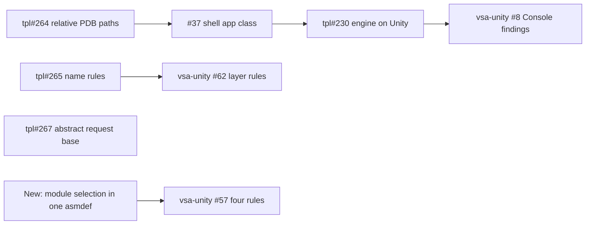

# Handover: Umpire template issues that block the Unity test suite

**Summary.** The vsa-unity test suite (`com.vsa.testsuite`) runs on Umpire 0.2.0-preview.11 with each kernel rule as an error. Six template gaps keep part of the architecture unchecked in Unity, and the test suite goes around them. The real fixes are in the template. This file gives each gap, its effect on the test suite, a proposed fix and the minimum that Unity needs.

Source: vsa-unity PR #61 (stage U of the test suite), merged into `claude/testsuite-core`.

## Order of the fixes



The engine chain (A to D) has the largest effect: with it, Unity checks the architecture rules (places, uses).

## Issues

| Issue | Gap | Test suite workaround |
|---|---|---|
| tpl#264 | Engine skips relative PDB paths | None; engine stops at UMP030501 |
| vsa-unity#37 | Shell app has no closed class | None; engine stops at UMP030502 |
| tpl#230 | Engine needs manual steps on Unity | Layer rules not checked |
| tpl#265 | Definition has no name rules | No check (vsa-unity#62 open) |
| tpl#267 | UMP010201 reports abstract request base | Rule off in one file |
| New | Module selection by assembly name | 4 VSA rules off (vsa-unity#57) |

<details>
<summary>tpl#264 · The engine skips Unity package code</summary>

**Effect.** Unity writes relative document paths in the PDB for code in `Packages/`. `BinDll.HasSourceUnder` keeps only rooted paths, so the engine finds no app DLL for the test suite and stops with UMP030501.

| Code place | PDB document path |
|---|---|
| `Assets/SpikeLab/` | `C:\...\Assets\SpikeLab\...cs` (rooted) |
| `Packages/com.vsa.testsuite/Spike/` | `.\Packages\com.vsa.testsuite\Spike\...cs` (relative) |

**Proposal.** Resolve a relative document path against the Unity project root before the prefix check.

**Unity minimum.** The engine accepts the relative paths that Unity writes for embedded and git packages.

</details>

<details>
<summary>vsa-unity#37 · A shell app has no closed app class</summary>

**Effect.** The engine finds the architecture from the most derived closed app class. `Shell<TPack>` makes a private nested `ShellApp : App<TPack>`, which is open generic. The test suite uses only a shell (`SpikeShell`), so the engine gives UMP030502 after the tpl#264 fix.

**Proposal.** The engine accepts a shell app as an app kind and reads the pack from `Shell<TPack>`. A closed class in `Shell` only to satisfy the engine changes the runtime for a tool.

**Unity minimum.** The engine finds the architecture of a consumer that uses only `Shell<TPack>` or `VsaShell`.

</details>

<details>
<summary>tpl#230 · The engine does not run on a Unity project without manual steps</summary>

**Effect.** Unity does not run the architecture rules (places, uses). A wrong use of a layer compiles. vsa-unity#8 (findings in the Unity Console) waits for this.

**Proposal.** For a Unity block, read the app DLLs from `Library/ScriptAssemblies` and the Umpire DLLs from the package plugin folders. Do not run a `dotnet` build step for a Unity project.

**Unity minimum.** One command runs the engine on a Unity project after a Unity compile, with no manual steps. The output can go to the Unity Console.

</details>

<details>
<summary>tpl#265 · The definition has no name rules</summary>

**Effect.** The test suite adds a `CliCommand` layer to each feature and plugin. Its rules are names: the class name and the CLI group name. The definition cannot state them, so the test suite has no check (vsa-unity#62).

| Control | Definition API |
|---|---|
| Folder | `Add<T>()`, `AddGroup<T>()` |
| Base type | `OfType<T>()` |
| Uses | `Uses<T>()`, `Denies<T>()` |
| Count | `Has<T>().AtLeast/AtMost/Exactly` |
| Type name | None |

**Proposal.** A name rule on a part, for example a suffix or a pattern, that the engine checks.

**Unity minimum.** A pack states the name rule of its own layer in its definition. No Roslyn analyzer of its own.

</details>

<details>
<summary>tpl#267 · UMP010201 reports an abstract request base</summary>

**Effect.** `SealedRecordRule` reports each type that implements `IRequest<T>`, also an abstract base. The test suite needs a typed base, so that C# infers the response type and `SessionBus.Send` accepts only test requests. UMP010201 is off in `TestRequestOfTResponse.cs`.

```csharp
public abstract record TestRequest<TResponse> : TestRequest, IRequest<TResponse>
    where TResponse : IResponse;   // UMP010201 here
public sealed record TouchObject(string Path) : TestRequest<TouchObjectResult>;   // no finding
```

**Proposal.** UMP010201 skips abstract types. It reports only the concrete request.

**Unity minimum.** No rule suppression in the test suite.

</details>

<details>
<summary>New issue · Module selection in one asmdef</summary>

**Effect.** Four VSA rules (UMP010203, UMP010205, UMP010206, UMP010207) select a module by assembly name. A Unity package often has one asmdef for all of its modules. The rules then find nothing. They also need `.umpireconfig`, which the Unity compiler does not read (vsa-unity#57). The four rules are off in the test suite.

**Proposal.** Select a module by namespace or by folder, not only by assembly name. Then decide how Unity gives the rule values to the compiler (for example `csc.rsp` with an additional file).

**Unity minimum.** The four rules run in one asmdef that holds more than one module.

</details>

## Unity minimum: summary

1. The engine runs on a Unity project with one command after a Unity compile.
2. The engine reads Unity package code and shell-only apps.
3. A pack states the name rules of its own layers in its definition.
4. An abstract request base gives no finding.
5. The VSA rules select modules in one asmdef.

## Open questions

- Is a shell app a first-class app kind for the engine, or must `Shell` give a closed app class?
- For module selection: namespace or folder?
