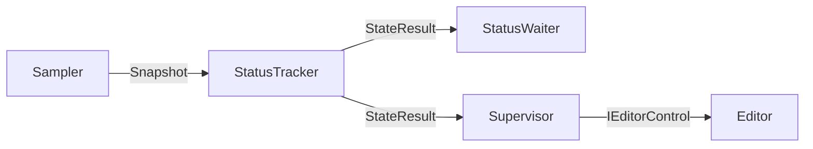
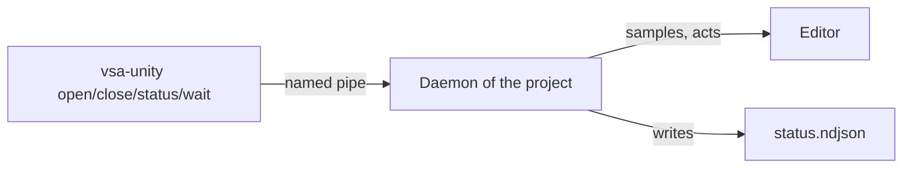

# VSA Test Suite

Drives a running game from the `unity` CLI and from C# scripts, with commands and evidence for each step.
It needs `com.unity.pipeline` 1.0.0, `com.umpire.unity` and Unity 6000.6 or later. Videos need `com.unity.recorder` 5.0 or later.

The test suite is a folder of this project (`Assets/TestSuite`) for now, not a package. Its package dependencies are in `Packages/manifest.json`.

| Folder | Contains |
|---|---|
| `Spike/` | The test suite, an Umpire app: commands, slices and the session |
| `SpikeEditor/` | The video recorder of the Editor |
| `Editor/Status/` | The status beacon and the main-thread probe of the status checker |
| `Client~/` | The status checker, the supervisor and the CLI `vsa-unity`, outside Unity |
| `Skills~/` | The skill that tells an agent when to call the CLI |
| `Documentation~/` | The rules of the CLI tools |

## Commands

The Pipeline server must run. In the Editor it runs by default. In a player, it runs only in a development build with the runtime pipeline on.

| Group | Commands |
|---|---|
| `touch` | `screen`, `object`, `hold_screen`, `hold_object`, `drag_screen`, `drag_object`, `show` |
| `objects` | `find`, `wait_for`, `assert_state`, `assert_text` |
| `scenes` | `load`, `reset` |
| `wait` | `frames`, `seconds` |
| `evidence` | `screenshot`, `folder` |
| `recording` | `start`, `stop`, `status` |
| `test_suite` | `list`, `run` |
| `session` | `info`, `end` |

Each session writes to one run folder. In the Editor the folder is in `TestRuns/` beside `Assets/`. In a player it is in `Application.persistentDataPath/TestRuns/`.

The input goes to uGUI objects only, through the EventSystem. The lab scenes and the lab scripts are in `Assets/SpikeLab`.

Only one Umpire app can run. If another app runs in the scene, the test suite app does not start.

## Status checker

The status checker is a .NET 8 library and a CLI that run outside Unity. Unity does not import folders whose name ends with `~`.

### Checker and supervisor

`Client~/Status/` classifies 26 Editor states from 12 signal sources. It never waits without a limit. The status checker reads only; the supervisor acts through `IEditorControl`.



| Folder | Contains |
|---|---|
| `Status/Sources/` | One file for each signal: probe, beacon, windows, log, descriptor, process |
| `Status/States/` | One file for each state. `States.All` is the check order: the first match wins |
| `Status/Core/` | Tracker, supervisor, sampler, waiter, `limits.json` (cap and stall window of each waiting state) |
| `Status/Control/` | `EditorControl` and `EditorLauncher`: own PID only, batch-mode compile check before each start |
| `Status/Daemon/` | `EditorDaemon` (one for each project) and `DaemonClient`, over a named pipe |
| `Status/Runs/` | `StatusReader` (one sample) and `RunLog` (run folders) |
| `Status/Replay/` | Replays recorded runs with the recorded time |

Rules of the checker:

- `/api/status` and the descriptor heartbeat say `ready` during a freeze. The checker uses a main-thread probe (`suite ping`, 2 s) and the beacon file.
- Unity's busy window is a `#32770` window with a `msctls_progress32` child. The checker finds it by this structure, so the rule works in all Editor languages.
- Progress is log growth, `/api/progress` text, beacon moves, and the bars and step text of Unity's progress windows. CPU time is never progress.
- A cap of 0 in `limits.json` means no cap. The stall window still applies.

The beacon is in the Editor assembly `VSA.TestSuite.Editor`. It is on by default and writes `Library/VSA.TestSuite/Status/beacon.json` once each second. `suite beacon --on false` or the flag `-vsaStatusBeaconOff` turns it off. If the daemon finds it off, it turns it on with `suite beacon --on true`, with no recompile.

### CLI and skill

`Client~/Cli/` is the thin CLI `vsa-unity` over the library: `open`, `close`, `status`, `wait`, `log sessions|show|mark` and `config show`. `Skills~/vsa-unity/SKILL.md` tells an agent when to call it and what each exit code means.



- `open` starts the daemon if none runs. With no Editor, the daemon runs the batch-mode compile check and starts the Editor with `-automated`. With a running Editor, it attaches. `open` returns when the Editor is ready.
- Adopt is the default: the daemon answers dialogs, escalates, stops and restarts one time. `open --observe` only answers dialogs.
- `close` refuses with unsaved changes and no `--save` or `--discard`. Else it quits, closes the window, then stops the PID.
- The daemon ends when the Editor exits or after `close`. A lock file allows one daemon for each project.

```bash
dotnet build Assets/TestSuite/Client~/Cli
dotnet Assets/TestSuite/Client~/Cli/bin/Debug/net8.0/vsa-unity.dll open --timeout 600
```

Tests: `dotnet test Assets/TestSuite/Client~/Tests`. They include the supervisor with a fake control, one test for each CLI command, and the replay of `Tools/StatusLab/results/final` (115 of 117 or better).
