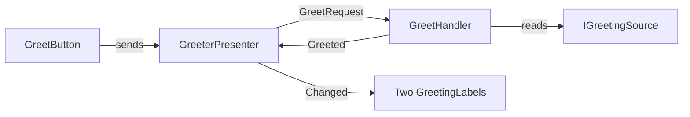

# VContainer sample

One scene uses VContainer and the VSA app together, in the two directions of `Umpire.Unity.VContainer`. Open `VContainerSample.unity` and enter Play Mode, then click **Greet**.

## One greeting through the two containers

| Part | Container | Direction |
|---|---|---|
| `IGreetingSource` | VContainer root scope, imported into the app | In |
| `GreetHandler`, `GreeterPresenter` | VSA app (`Greeter` module) | None |
| `GreetButton`, `GreetingLabel` | VContainer scene scope, `[Inject]` | Out |

## Files

| Path | Contains |
|---|---|
| `Greeter/` | The VSA module: request, handler, presenter, `IGreetingSource` |
| `GreeterHost.cs` | The Unity host with the module list: `base(new GreeterModule())` |
| `SampleRootScope.cs` | `VsaLifetimeScope<Vsa<GreeterHost>>`: starts the app, imports `IGreetingSource` |
| `GreeterSceneScope.cs` | The child scope: `RegisterVsaPresenters` |
| `GreetButton.cs`, `GreetingLabel.cs` | The views |
| `Editor/VContainerSampleScene.cs` | Writes the scene: **Tools > Umpire > Write VContainer Sample Scene** |
| `Tests/` | A PlayMode test that loads the scene and clicks **Greet** |

- `GreeterHost` gives the module list, so the app of this sample does not get the `Sample` module of `SampleApp`.
- The two labels show the same text: one scene scope shares one presenter.
