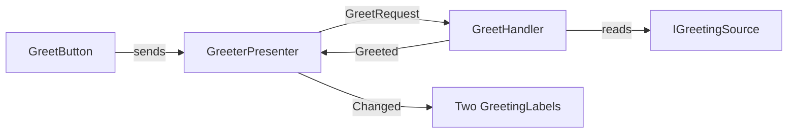

# VContainer sample

One scene uses VContainer and the VSA app together, in the two directions of `VSA.Unity.VContainer`. Open `VContainerSample.unity` and enter play mode, then click **Greet**.

## One greeting through the two containers

| Part | Container | Direction |
|---|---|---|
| `IGreetingSource` | VContainer root scope, imported into the app | In |
| `GreetHandler`, `GreeterPresenter` | VSA app (`Greeter` module) | None |
| `GreetButton`, `GreetingLabel` | VContainer scene scope, `[Inject]` | Out |

## Files

| Path | Contains |
|---|---|
| `Greeter/` | The VSA module: request, handler, presenter, `IGreetingSource` |
| `VContainerSampleApp.cs` | The app: `Modules(new GreeterModule())`, `UseVContainer()` |
| `SampleRootScope.cs` | `VsaLifetimeScope<VContainerSampleApp>`: starts the app, imports `IGreetingSource` |
| `GreeterSceneScope.cs` | The child scope: `RegisterVsaPresenters` |
| `GreetButton.cs`, `GreetingLabel.cs` | The views |
| `Editor/VContainerSampleScene.cs` | Writes the scene: **Tools > VSA > Write VContainer Sample Scene** |
| `Tests/` | A PlayMode test that loads the scene and clicks **Greet** |

- The `Greeter` module has no `VsaModule` metadata, so the module scan of `SampleApp` does not find it.
- The two labels show the same text: one scene scope shares one presenter.
