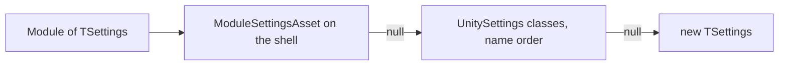

# com.vsa.core

The Umpire framework (0.2.0-preview.20) for Unity 6000.6: the portable Umpire DLLs of the VSA pack, the Umpire analyzers, the Unity host and the uGUI view bases.
A Unity app starts with one shell component on a GameObject of the first scene. Views inherit `PresenterComponent<T>`.

## Install

Add the package to `Packages/manifest.json`:

```json
"com.vsa.core": "https://github.com/MgCohen/vsa-unity.git?path=/Packages/com.vsa.core#latest"
```

The tag `latest` is the last commit of `main`. To get a later commit, click **Update** in the Package Manager.

Each rule has its default values and its default severity on its class, so the package ships no rule values.

## Contents

| Path | Contains |
|---|---|
| `Runtime/Plugins/` | `Umpire.dll` and its third-party dependencies (11 DLLs) |
| `Runtime/*.Analyzers.dll` | `Umpire.Kernels.Analyzers`, `Umpire.Vsa.Analyzers` (Roslyn 4.10), the same version as `Umpire.dll` |
| `Runtime/` | Shells, `UnityHost`, settings sources, `PresenterComponent<T>` |
| `Runtime/Factories/` | `Umpire.Factories`: `AddFactory`, `IFactory<TArg, T>`, `IBindable<T>`. No engine references. |
| `Runtime/UnityFactories/` | `Umpire.Unity.Factories`: `Bound<T>`, `IPrefabFactory<T>`, `AddPrefabFactory` |
| `Runtime/VContainer/` | `VsaLifetimeScope<TPack>`, `RegisterVsa`, if VContainer is installed |
| `Tests/` | EditMode and PlayMode tests |

Unity 6 ships `System.Text.Json`, `System.Collections.Immutable` and the `Microsoft.Extensions.*.Abstractions` DLLs of DI and logging. The package does not ship a second copy, because a second copy is a compile error.

## Start the app

Put one shell on one GameObject of the first scene.

| App | Shell |
|---|---|
| VSA, Unity host, no hooks | `class GameShell : VsaShell { }` |
| VSA, Unity host, hooks or own architecture | `class GameShell : VsaShell<VsaArchitecture>` |
| Other pack or other host | `class GameShell : Shell<Vsa<GameHost>>` |

Always put your own shell class in `Assets`. Each shell implements `IAppEntry<TPack>`, and the rule engine finds the app from the most derived shell class in the app code. A package from a git URL is in `Library/PackageCache`, which is not app code. So `VsaShell` itself on a GameObject runs, but the engine does not find the app (`UMP030502`).

```csharp
public sealed class GameShell : VsaShell<VsaArchitecture> {
    protected override void OnStart() => Debug.Log("The app runs.");

    protected override void OnStop() => Debug.Log("The app stopped.");
}
```

```
Shell.Awake
├─ DontDestroyOnLoad          the app has the lifetime of the Unity app
├─ CreateApp                  an App<TPack> whose hooks go to the shell
└─ App.Start(Arguments)       returns at once: Unity owns the frame loop
   └─ TPack.CreateHost()      UnityHost: Unity log, main-thread dispatch, settings
Shell.OnDestroy               Play Mode exit, player quit: App.Stop()
```

| `Shell` member | Use |
|---|---|
| `Arguments` | The `args` of `App.Start` |
| `Settings` (Inspector) | The `ModuleSettingsAsset` assets of the app |
| `Services` (static) | The services of the running app, else null |
| `AppIsRunning` (static) | True while the app runs |
| `State` | The state of the app of this shell: `Stopped`, `Running` or `Stopping` |
| `Owner` (static) | The shell that owns the app, else null |
| `Stop()`, `Run()` | Stop the app, and start it again. `Run()` starts the app only from `Stopped`. |

- A second shell disables itself and does nothing. A scene change does not stop the app.
- `AppHost` reads `--Key=Value` and `--Key value` of the arguments into `IConfiguration`. It ignores other arguments, for example `-batchmode`.

## The Unity host

| Item | Behavior |
|---|---|
| Log | `UnityLogProvider` writes to the Unity console |
| Presenter scope | One app is one presenter scope. It is live from the host start to the host end. |
| Presenter events | A presenter (`IPresenterHandler<T>`) gets each event on the thread of the publish. `PresenterComponent` moves each `Render` to the main thread. |
| Settings | Assets on the shell, then `UnitySettings` classes |
| Modules | `ScannedModules` (the module scan), or `FixedModules` (the list of a derived host) |

Without a module list, Umpire finds the modules in each loaded assembly that references `Umpire.Kernels`, apart from test assemblies. The Editor loads each assembly of the project, so two apps in one project see the modules of both. To give the modules of one app, derive a host:

```csharp
public sealed class GameHost : UnityHost {
    public GameHost() : base(new ScoreModule(), new DeckModule()) { }
}

public sealed class GameShell : Shell<Vsa<GameHost>> { }
```

The module name is the last part of the namespace of the module class. `FixedModules` refuses two modules with the same type or the same name.

## Module settings

`UnityHost` gives the settings of a `Module<TSettings>` from these sources. The first source that gives settings wins.



```csharp
[CreateAssetMenu(menuName = "Game/Score Settings")]
public sealed class ScoreSettingsAsset : ModuleSettingsAsset<ScoreModule, ScoreSettings> {
    public int Limit = 10;

    protected override ScoreSettings Create() => new ScoreSettings { Limit = Limit };
}

public sealed class GameSettings : UnitySettings {
    public override TSettings Get<TSettings>(Module module) =>
        module is ScoreModule ? new ScoreSettings { Limit = 5 } as TSettings : null;
}
```

- Unity serializes fields, not properties, and it cannot serialize a `Dictionary`. Keep a list of pairs in the asset, and make the dictionary in `Create`.
- `UnityHost` finds the `UnitySettings` classes in the module assemblies and in the assembly of the shell.
- The host does not read `.umpireconfig`.

## Factories

A module registers each factory. Code injects the typed factory, not the container.

`IFactory<T>` is the template interface `Umpire.Kernels.IFactory<T>`. `Umpire.Factories` adds `IFactory<TArg, T>`, the `AddFactory` forms below and the bind step. A module file can use both namespaces.

```csharp
public override void Configure(IServiceCollection services) {
    services.AddFactory<CounterModel>();                                       // also registers CounterModel
    services.AddFactory<int, Label>((provider, size) => new Label(size));      // with an argument
}

public Board(IFactory<CounterModel> models, IFactory<int, Label> labels) { ... }
```

| Form | Registers | `Create` |
|---|---|---|
| `AddFactory<T>()` | `IFactory<T>`, and T as transient if T has no registration | Resolves T. If T is scoped, each `Create` in one scope gives the same T. |
| `AddFactory<T>(create)` | `IFactory<T>` | Calls `create(provider)` |
| `AddFactory<TArg, T>(create)` | `IFactory<TArg, T>` | Calls `create(provider, arg)` |
| `AddFactory<T, TFactory>()` | `IFactory<T>`, and TFactory as transient if it has no registration | Calls `TFactory.Create()` |
| `AddFactory<T, TService>(service => ...)` | Template form (`Umpire.Kernels`): `IFactory<T>` | Calls the function with a TService |

- The first registration of a type wins. A call does not replace a factory or a product that exists.
- The two forms with two type arguments differ by the function: one parameter is the template form, two parameters (`provider, arg`) is the form with an argument.
- A factory resolves from the scope that resolves it. A scoped product is one for each scope.
- A transient product or factory class that is `IDisposable` stops the start: the scope keeps each disposable transient until it ends. Register it as scoped or singleton first.
- A product of `AddFactory<T>(create)` or `AddFactory<TArg, T>(create)` is not in the container. The caller owns it.

### Bind a product

If a product is `IBindable<T>`, the factory gets a T and calls `Bind` before `Create` returns.

```csharp
public sealed class Label : IBindable<CounterModel> {
    public void Bind(CounterModel target) => ...;
}
```

| T has | T comes from |
|---|---|
| A factory (`AddFactory<T>`) | That factory: a new T for each product |
| A registration only | The scope, for example a scoped presenter |
| Neither | An error that names T |

- `IBinder.Bind(object)` binds an object that no factory made. If the object is not `IBindable<T>`, it does nothing.
- `IBinder.Bind(object, arg)` gets the T from `AddFactory<TArg, T>` with that argument.
- A product binds to one type only.
- Do not let T bind back to the type of the product. Each `Bind` then makes the other object again, with no end. No check stops it.

### Prefab factories

`Umpire.Unity.Factories` makes copies of prefabs and binds their behaviours. A behaviour derives from `Bound<T>`. It can be a view, a character or any other object.

```csharp
public sealed class Character : Bound<CharacterModel> {
    protected override void OnBind() => transform.position = Target.Spawn;
    protected override void OnRelease() { }
}

services.AddPrefabFactory<Character>();                                         // also registers CharacterModel
services.AddFactory<ItemData, ItemModel>((provider, data) => new ItemModel(data));
services.AddPrefabFactory<ItemData, ItemView>();                                // ItemView : Bound<ItemModel>

public Wave(IPrefabFactory<Character> characters) { ... }
var copy = characters.Create(prefab, parent);
```

```text
IPrefabFactory<Character>.Create(prefab, parent)
├─ Object.Instantiate          Awake of the copy runs
├─ IBinder.Bind(behaviour)     each MonoBehaviour of the copy, also inactive ones
└─ return the copy             Start runs later, so Target is set in Start
```

| Item | Behavior |
|---|---|
| `AddPrefabFactory<TComponent>()` | Registers the T of `Bound<T>` as transient if T has no registration. A scanned presenter stays scoped. |
| `AddPrefabFactory<TArg, TComponent>()` | The component of the prefab type binds with the argument. The other behaviours bind with no argument. |
| `Bound<T>.Bind` | Same target: nothing. Other target: `OnRelease`, then `OnBind`. |
| Destroy of the copy | `OnRelease`. The target is not disposed. |
| Prefab with no `Bound<T>` | A plain copy |

- The caller gives the prefab at each call.
- An override of `OnDestroy` calls the base method.

## Views

```csharp
public sealed class CounterLabel : PresenterComponent<CounterPresenter> {
    [SerializeField] Text label;

    protected override void Render() => label.text = $"{Presenter.Value} of {Presenter.Max}";
}
```

| Item | Behavior |
|---|---|
| Presenter | From `Bind` only. The view never resolves it. |
| Render | On `Bind` and on `Changed`, on the main thread |
| `Bind` again | Same presenter: nothing. Other presenter: stops to listen to the last one. |
| `OnDestroy` | Stops to listen. The scope that gave the presenter owns it. |

- The app injects the scene views. A factory or VContainer can call `Bind` before that.
- An override of `OnDestroy` calls the base method.

### Scene views

The app scope gives the presenters of the scene views. `UnityHost` makes this scope at its start, makes it live, and disposes it at its end, before the services of the app.

```text
UnityHost.Start ── app scope: live ── inject each loaded scene ── App.OnStart
SceneManager.sceneLoaded ── inject that scene          (after Awake, before Start)
App.Stop ── views release their presenters ── app scope disposed ── services disposed
```

| Case | Result |
|---|---|
| Two views of one presenter type | One presenter. All views of the app share it. |
| Scene change | The presenter and its state stay |
| Destroy of a view | The presenter stays and gets its events |
| View with a presenter at the injection | It keeps that presenter |
| Inactive view | It gets its presenter |
| View that `Instantiate` makes after the scene load | No presenter. A factory must call `Bind`. |
| App stop | The views release their presenters. A new start injects them again. |
| No app runs | The view gets no presenter and shows no error |

- A view has its presenter in `Start`, because Unity raises `sceneLoaded` before `Start`.
- To get a second presenter scope, start a second app.
- In an app that a VContainer root scope starts, an `[Inject]` that calls `Bind` replaces the presenter of the app scope.

## VContainer

The assembly `Umpire.Unity.VContainer` connects VContainer and the VSA app in two directions. Unity compiles it only if the project has VContainer 1.16.0 or later (`jp.hadashikick.vcontainer`).

| Direction | API | Use |
|---|---|---|
| Out: VContainer gets VSA services | `builder.RegisterVsa<T>()`, `RegisterVsaPresenters(modules)` | Scene objects get presenters |
| In: VSA gets VContainer services | `Import(VsaImports)` | Handlers get Unity services |

### Start the app from the root scope

`VsaLifetimeScope<TPack>` is the VContainer root scope. It starts the app, so it replaces the shell. The host of the pack must be `UnityHost` or a class derived from it.

```csharp
public sealed class GameScope : VsaLifetimeScope<Vsa<GameHost>> {
    protected override void ConfigureScope(IContainerBuilder builder) => builder.Register<IAudio, UnityAudio>(Lifetime.Singleton);

    protected override void Import(VsaImports imports) => imports.Add<IAudio>();
}
```

```
GameScope.Awake
├─ Configure            registers VsaScope, then ConfigureScope
├─ VContainer build     the root scope
├─ build callback
│  ├─ Resolve imports   one time, from the root scope
│  ├─ App.Start         UnityHost adds the imports as singletons
│  └─ Inject            autoInjectGameObjects of the root scope
└─ Entry points         IInitializable, IStartable: the app runs
```

| Item | Behavior |
|---|---|
| Imports | Singletons in the app. VContainer owns them, so the app does not dispose them. |
| Host not `UnityHost` | If the scope has imports, the build fails and the app stops. |
| A running app | If a shell started an app, the build fails. |
| `OnDestroy` | Disposes the VContainer scope, then stops the app. |

### Give presenters to a scene

Each VContainer scope has one `VsaScope`, an `IServiceScope` of the app. A VSA service resolves from the `VsaScope` of the scope that resolves it.

```csharp
public sealed class LevelScope : LifetimeScope {
    protected override void Configure(IContainerBuilder builder) => builder.RegisterVsaPresenters(new LevelModule());
}

public sealed class ScoreLabel : PresenterComponent<ScorePresenter> {
    [Inject] public void Construct(ScorePresenter presenter) => Bind(presenter);
    protected override void Render() => ...;
}
```

| Item | Behavior |
|---|---|
| One scope | All views share one presenter |
| Two scopes | Two presenters |
| Scope destroyed | The `VsaScope` disposes its presenters |
| No app runs | The resolve fails with "No VSA app runs" |

- Why no copy of the registrations: VContainer refuses two registrations of one implementation type, and VSA registers several instances of one type and reads them as a list (`AddPipeline`). So the VSA services stay in the Microsoft container. A singleton comes from the root, and a scoped or transient service comes from the `VsaScope` of the VContainer scope.
- `RegisterVsa` works in each scope, also with an app that a shell started. Only the In direction needs `VsaLifetimeScope`.
- VContainer does not keep or dispose a VSA service. The `VsaScope` does both.
- `Assets/VContainerSample/` of the repository is a sample scene of the two directions.

## Analyzers

`Runtime/Umpire.Kernels.Analyzers.dll` and `Runtime/Umpire.Vsa.Analyzers.dll` have the label `RoslynAnalyzer` and no platform. Unity uses them as analyzers, not as libraries. The two DLLs must be in one folder, with no other DLL in that folder.

The kernel analyzer embeds its config reader (Tomlyn) and loads it in a private load context. So the analyzers load in the compiler of Unity 6000.6, which has `System.Collections.Immutable` 8.0. If the config reader does not load, the compiler gives `UMP010003`.

| Assembly | Umpire rules | Rule values from |
|---|---|---|
| A consumer asmdef that references `Umpire.Unity` | Yes | The defaults, or `Assets/Default.globalconfig` |
| `Assembly-CSharp`, `Assembly-CSharp-Editor` | Yes | The defaults, or `Assets/Default.globalconfig` |
| A consumer asmdef with no `Umpire.Unity` reference | No | None |
| The package asmdefs | Off | `<AsmdefName>.globalconfig` |

- The analyzer folder sets the scope: Unity runs the analyzers on `Umpire.Unity` and on each assembly that references it.
- Module asmdefs often do not reference `Umpire.Unity`. The .NET test build checks the module code.
- To change a severity, write `dotnet_diagnostic.<rule ID>.severity = <value>` in `Assets/Default.globalconfig`. Unity reads this file for all assemblies.
- A `<AsmdefName>.globalconfig` next to an asmdef replaces `Assets/Default.globalconfig` for that asmdef.
- The analyzers read other rule values from `.umpireconfig` only. Unity does not give that file to the compiler yet (#57), so these values stay at their defaults.
- The package code is framework code, so each package asmdef sets the `UMP` rules to `none`.
- The package code is C# 9, the default language version of Unity 6000.6.

## Code rules in Unity

- A `MonoBehaviour` uses a block namespace (`namespace X { }`), not a file-scoped namespace.
- An assembly definition (`.asmdef`) is one layer. Its references give the layers and the Umpire DLLs that the layer can use.
- Unity compiles app code as C# 9. A record needs `IsExternalInit` in the assembly (#31).

## Rule engine

The Umpire rule engine checks the places and the uses of the architecture after a Unity compile. Unity does not run it yet (#8). A manual run on the dice sample of this repository works:

```bash
dotnet umpire-engine.dll --project <Unity project> --block Assets/<App> --bin Library/ScriptAssemblies --stage Check
```

`umpire-engine.dll` is in the `Umpire.Sdk` NuGet package, folder `tools/net10.0`. It needs .NET 10. The Unity 6000.6 Editor has .NET 8 only (MgCohen/vsa-template#292).

Write `.umpireconfig` in the block folder (`Assets/<App>`). A relative path starts at the folder of the file.

```toml
[umpire.check]
references = "<project>/Library/ScriptAssemblies, <project>/Packages/com.vsa.core/Runtime/Plugins, <Editor>/Data/Managed/UnityEngine"
source_root = "<project>"
project_checks = false

[umpire.check.folder_aliases]
"" = ["", "App"]
```

| Key | Why |
|---|---|
| `references` | The DLLs that the app uses: the Unity compile output, the Umpire DLLs and UnityEngine |
| `source_root` | Unity writes relative source paths in the PDB of package code |
| `ignored_folders` | Set it when the block holds `Library`, `Temp`, `Logs` or `UserSettings`. The engine has no default. |
| `project_checks = false` | Unity writes the `.csproj` files, so the engine does not check them |
| `folder_aliases` | Only from the `.umpireconfig` in the block folder. The key `""` is the block root. |

- Give one block for each app. Without `--block`, the engine sees each shell of the project and stops (`UMP030503`).
- Each finding is one line: `file(line,col): error CODE: text`.
- The dice sample gives 2 known errors: a view uses `PresenterComponent` and `IPresenterView` (MgCohen/vsa-template#232).
- A .NET project of the same app (code outside `Assets`) sets `UmpireExcludedFolders` to `Assets;Library;Temp;Logs;UserSettings;node_modules`.

## IL2CPP

The package supports managed stripping Minimal and Low. It has no `link.xml`, and Umpire has no linker markers. At Minimal and Low, the linker strips no user type. Open generics over structs work on IL2CPP: Umpire closes each open type before the container gets it. The rules are in the open generics guide (see `AGENTS.md`).

| Stripping | Result (probe, IL2CPP, no `link.xml`) |
|---|---|
| Minimal, Low | Pass |
| Medium, High | Not supported. The `[AutoRegister]` and `[AutoClose]` markers stay. The linker removes the constructor of each `[AutoRegister]` class that only DI calls, so its resolve fails (MgCohen/vsa-template#223). |

| Player of the sample check | Stripping | Result |
|---|---|---|
| Mono | Minimal | Pass |
| IL2CPP | Minimal | Pass |

## Open questions

The open questions are GitHub issues: https://github.com/MgCohen/vsa-unity/issues. For example, the package id is #26.

- Unity CI: a Unity license in GitHub Actions needs a license secret. The Unity checks run on a dev computer only.
- The package keeps the Umpire DLLs in git, because Unity cannot restore NuGet packages (`vendor.cs`).
