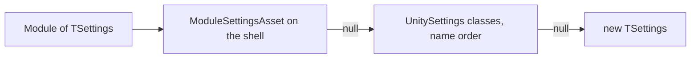

# com.vsa.core

The Umpire framework (0.2.0-preview.5) for Unity 6000.6: the portable Umpire DLLs of the VSA pack, the Umpire analyzers, the Unity host and the uGUI view bases.
A Unity app starts with one shell component on a GameObject of the first scene. Views inherit `PresenterComponent<T>`.

## Install

1. Copy [`Documentation~/Default.globalconfig`](Documentation~/Default.globalconfig) to `Assets/Default.globalconfig`.
2. Add the package to `Packages/manifest.json`:

```json
"com.vsa.core": "https://github.com/MgCohen/vsa-unity.git?path=/Packages/com.vsa.core#latest"
```

The tag `latest` is the last commit of `main`. To get a later commit, click **Update** in the Package Manager.

The rules have default values, so a project compiles without step 1. Step 1 gives the rule values and the disabled rules of the Umpire version of the package.

## Contents

| Path | Contains |
|---|---|
| `Runtime/Plugins/` | The Umpire DLLs and their dependencies (26 DLLs) |
| `Runtime/*.Analyzers.dll` | `Umpire.Kernels.Analyzers`, `Umpire.Vsa.Analyzers` (Roslyn 4.10), version 0.2.0-preview.3 (see "Analyzers") |
| `Runtime/` | Shells, `UnityHost`, settings sources, `PresenterComponent<T>` |
| `Runtime/VContainer/` | `VsaLifetimeScope<TPack>`, `RegisterVsa`, if VContainer is installed |
| `Documentation~/Default.globalconfig` | The rule values for the install step |
| `Editor/` | `CompilerFiles` |
| `Tests/` | EditMode and PlayMode tests |

Unity 6 ships `System.Text.Json`, `System.Collections.Immutable` and the `Microsoft.Extensions.*.Abstractions` DLLs of DI and logging. The package does not ship a second copy, because a second copy is a compile error.

## Start the app

Put one shell on one GameObject of the first scene.

| App | Shell |
|---|---|
| VSA, Unity host, no hooks | `VsaShell` on the GameObject |
| VSA, Unity host, hooks or own architecture | `class GameShell : VsaShell<VsaArchitecture>` |
| Other pack or other host | `class GameShell : Shell<Vsa<GameHost>>` |

```csharp
public sealed class GameShell : VsaShell<VsaArchitecture> {
    protected override void OnStart() => Debug.Log("The app runs.");

    protected override void OnStop() => Debug.Log("The app stopped.");
}
```

```
Shell.Awake
├─ DontDestroyOnLoad          the app has the lifetime of the Unity app
├─ CreateApp                  an App<TPack> whose hooks go to the shell
└─ App.Start(Arguments)       returns at once: Unity owns the frame loop
   └─ TPack.CreateHost()      UnityHost: Unity log, main-thread dispatch, settings
Shell.OnDestroy               Play Mode exit, player quit: App.Stop()
```

| `Shell` member | Use |
|---|---|
| `Arguments` | The `args` of `App.Start` |
| `Settings` (Inspector) | The `ModuleSettingsAsset` assets of the app |
| `Services` (static) | The services of the running app, else null |
| `AppIsRunning` (static) | True while the app runs |
| `State` | The state of the app of this shell: `Stopped`, `Running` or `Stopping` |
| `Owner` (static) | The shell that owns the app, else null |
| `Stop()`, `Run()` | Stop the app, and start it again. `Run()` starts the app only from `Stopped`. |

- A second shell disables itself and does nothing. A scene change does not stop the app.
- `AppHost.Build` does not read the arguments, so the app gets no configuration from them.

## The Unity host

| Item | Behavior |
|---|---|
| Log | `UnityLogProvider` writes to the Unity console |
| Presenter events | `LivePresenters.Dispatch` runs them after `Awaitable.MainThreadAsync()` |
| Settings | Assets on the shell, then `UnitySettings` classes |
| Modules | The module scan, or the list of a derived host |

Without a module list, Umpire finds the modules in each loaded assembly that references `Umpire.Kernels`, apart from test assemblies. The Editor loads each assembly of the project, so two apps in one project see the modules of both. To give the modules of one app, derive a host:

```csharp
public sealed class GameHost : UnityHost {
    public GameHost() : base(new ScoreModule(), new DeckModule()) { }
}

public sealed class GameShell : Shell<Vsa<GameHost>> { }
```

The module name is the last part of the namespace of the module class.

## Module settings

`UnityHost` gives the settings of a `Module<TSettings>` from these sources. The first source that gives settings wins.



```csharp
[CreateAssetMenu(menuName = "Game/Score Settings")]
public sealed class ScoreSettingsAsset : ModuleSettingsAsset<ScoreModule, ScoreSettings> {
    public int Limit = 10;

    protected override ScoreSettings Create() => new ScoreSettings { Limit = Limit };
}

public sealed class GameSettings : UnitySettings {
    public override TSettings Get<TSettings>(Module module) =>
        module is ScoreModule ? new ScoreSettings { Limit = 5 } as TSettings : null;
}
```

- Unity serializes fields, not properties, and it cannot serialize a `Dictionary`. Keep a list of pairs in the asset, and make the dictionary in `Create`.
- `UnityHost` finds the `UnitySettings` classes in the module assemblies and in the assembly of the shell.
- The host does not read `.umpireconfig`.

## Views

```csharp
public sealed class CounterLabel : PresenterComponent<CounterPresenter> {
    [SerializeField] Text label;

    protected override void Render() => label.text = $"{Presenter.Value} of {Presenter.Max}";
}
```

| Item | Behavior |
|---|---|
| Presenter | `Bind`, else an app scope in `Start` |
| Render | On `Bind` and on `Changed`, on the main thread |
| `Bind` again | Same presenter: nothing. Other presenter: stops to listen to the last one. |
| `OnDestroy` | Stops to listen. Disposes the scope that the view made. |

- A factory calls `Bind`. A view in a scene with no `Bind` gets its presenter from a new scope of the running app.
- An override of `Start` or `OnDestroy` calls the base method.

### Scene views

Unity makes the views of a scene, so no factory calls `Bind`. The `Start` fallback gives these views a presenter. It has these limits:

| Limit | Result |
|---|---|
| Each scene view makes its own scope | Two views of one presenter type get two presenters. They do not share state. |
| The view reads the static `Shell.Services` | A service locator: an exception to the composition rule |
| No app runs at `Start` | The view gets no presenter and shows no error |

If a consumer needs shared presenters or injection into scene objects, use [VContainer](#vcontainer). A view that has a presenter before `Start` does not use the fallback.

## VContainer

The assembly `Umpire.Unity.VContainer` connects VContainer and the VSA app in two directions. Unity compiles it only if the project has VContainer 1.16.0 or later (`jp.hadashikick.vcontainer`).

| Direction | API | Use |
|---|---|---|
| Out: VContainer gets VSA services | `builder.RegisterVsa<T>()`, `RegisterVsaPresenters(modules)` | Scene objects get presenters |
| In: VSA gets VContainer services | `Import(VsaImports)` | Handlers get Unity services |

### Start the app from the root scope

`VsaLifetimeScope<TPack>` is the VContainer root scope. It starts the app, so it replaces the shell. The host of the pack must be `UnityHost` or a class derived from it.

```csharp
public sealed class GameScope : VsaLifetimeScope<Vsa<GameHost>> {
    protected override void ConfigureScope(IContainerBuilder builder) => builder.Register<IAudio, UnityAudio>(Lifetime.Singleton);

    protected override void Import(VsaImports imports) => imports.Add<IAudio>();
}
```

```
GameScope.Awake
├─ Configure            registers VsaScope, then ConfigureScope
├─ VContainer build     the root scope
├─ build callback
│  ├─ Resolve imports   one time, from the root scope
│  ├─ App.Start         UnityHost adds the imports as singletons
│  └─ Inject            autoInjectGameObjects of the root scope
└─ Entry points         IInitializable, IStartable: the app runs
```

| Item | Behavior |
|---|---|
| Imports | Singletons in the app. VContainer owns them, so the app does not dispose them. |
| Host not `UnityHost` | If the scope has imports, the build fails and the app stops. |
| A running app | If a shell started an app, the build fails. |
| `OnDestroy` | Disposes the VContainer scope, then stops the app. |

### Give presenters to a scene

Each VContainer scope has one `VsaScope`, an `IServiceScope` of the app. A VSA service resolves from the `VsaScope` of the scope that resolves it.

```csharp
public sealed class LevelScope : LifetimeScope {
    protected override void Configure(IContainerBuilder builder) => builder.RegisterVsaPresenters(new LevelModule());
}

public sealed class ScoreLabel : PresenterComponent<ScorePresenter> {
    [Inject] public void Construct(ScorePresenter presenter) => Bind(presenter);
    protected override void Render() => ...;
}
```

| Item | Behavior |
|---|---|
| One scope | All views share one presenter |
| Two scopes | Two presenters |
| Scope destroyed | The `VsaScope` disposes its presenters |
| No app runs | The resolve fails with "No VSA app runs" |

- `RegisterVsa` works in each scope, also with an app that a shell started. Only the In direction needs `VsaLifetimeScope`.
- VContainer does not keep or dispose a VSA service. The `VsaScope` does both.
- `Assets/VContainerSample/` of the repository is a sample scene of the two directions.

## Analyzers

`Runtime/Umpire.Kernels.Analyzers.dll` and `Runtime/Umpire.Vsa.Analyzers.dll` have the label `RoslynAnalyzer` and no platform. Unity uses them as analyzers, not as libraries.

The analyzers are version 0.2.0-preview.3 (`UmpireAnalyzerVersion` in `Vendor/UmpireVendor.csproj`). The analyzers of preview.4 and later need `System.Collections.Immutable` 9.0, and the compiler of Unity 6000.6 (.NET SDK 8.0) has 8.0. So they do not load: the compiler gives `CS8032`, and Unity does not show it. The analyzers read source code only, so their version does not need to match the runtime DLLs.

| Assembly | Umpire rules | Rule values from |
|---|---|---|
| A consumer asmdef that references `Umpire.Unity` | Yes | `Assets/Default.globalconfig` |
| `Assembly-CSharp`, `Assembly-CSharp-Editor` | Yes | `Assets/Default.globalconfig` |
| A consumer asmdef with no `Umpire.Unity` reference | No | None |
| The package asmdefs | Off | `<AsmdefName>.globalconfig` |

- The analyzer folder sets the scope: Unity runs the analyzers on `Umpire.Unity` and on each assembly that references it.
- Module asmdefs often do not reference `Umpire.Unity`. The .NET test build checks the module code.
- A `<AsmdefName>.globalconfig` next to an asmdef replaces `Assets/Default.globalconfig` for that asmdef.
- The package code is framework code, so each package asmdef sets the `UMP` rules to `none`.

## Editor scripts

| Script | Does |
|---|---|
| `CompilerFiles` | Updates `Assets/Default.globalconfig` |

- `Assets/Default.globalconfig` gets the block of `Documentation~/Default.globalconfig` between the `# BEGIN com.vsa.core` and `# END com.vsa.core` lines. The block holds the text of `build/Umpire.Kernels.Analyzers.globalconfig` and `build/Umpire.Vsa.Analyzers.globalconfig` of the NuGet package. Unity reads only this name for all assemblies.
- The script changes only its own lines. The menu item **Tools > Umpire > Write Compiler Files** runs `CompilerFiles` again.
- The package code is C# 9, the default language version of Unity 6000.6.

## IL2CPP

The package supports managed stripping Minimal. It has no `link.xml`. Umpire marks the bases that it makes from a `Type` with `[RequireImplementors]` or `[RequireDerived]`, so the linker keeps them.

| Stripping | Result (probe, IL2CPP, no `link.xml`) |
|---|---|
| Minimal | Pass |
| Medium, High | The `[AutoRegister]` and `[TypeArgument]` markers stay. The linker removes the constructor of each `[AutoRegister]` class that only DI calls, so its resolve fails. |

| Player of the sample check | Stripping | Result |
|---|---|---|
| Mono | Minimal | Pass |
| IL2CPP | Minimal | Pass |

## Open questions

- Package name: the package id is `com.vsa.core`, and the assemblies are `Umpire.Unity.*`. Does the package get an Umpire id?
- Arguments: does `UnityHost` give the shell arguments to the app configuration?
