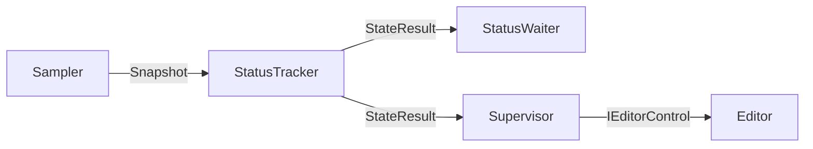
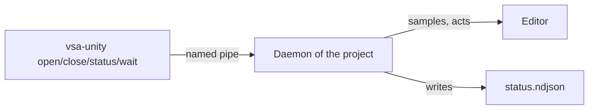

# com.vsa.testsuite

Drives a running game from the `unity` CLI and from C# scripts. Commands call actions, actions call systems, and hooks record evidence for each step.
The package needs `com.unity.pipeline` 1.0.0 and Unity 6000.6 or later. It has no VSA reference.

## Install

Add the package to `Packages/manifest.json`:

```json
"com.vsa.testsuite": "https://github.com/MgCohen/vsa-unity.git?path=/Packages/com.vsa.testsuite#latest"
```

The Pipeline server must run: in the Editor it runs by default. In a player, it runs only in a development build with the runtime pipeline on.

## Layers

```
unity command ui.click_object --path Canvas/Play      1 command: CLI args to one action
  └─ Actions.Run                                         static entry, builds the runtime on the first call
     └─ ActionPipeline                                   hooks before and after each action
        └─ ClickObjectHandler                            2 action: routing only
           ├─ ctx.Run(FindObject)  → ObjectSystem.Find   3 system: all logic
           └─ ctx.Run(ClickScreen) → PointerSystem.Click
                                       └─ IPointerInput  4 input path
```

| Layer | Rule |
|---|---|
| Command | Maps the CLI args to one action. No logic. |
| Action | Calls one system, or other actions with `ctx.Run`. No logic. |
| System | All logic. A plain class, no base class. |
| Hook | Work for every action: log, console, step record, run summary, screenshot. |

## Commands

| Command | Action | Result |
|---|---|---|
| `ui.find_object --path P` | `FindObject` | Path and screen point |
| `ui.click_screen --x X --y Y` | `ClickScreen` | Point, top UI object, input path, frames |
| `ui.click_object --path P` | `ClickObject` (composite) | Same as `click_screen` |
| `ui.wait_for_object --path P [--state Active] [--timeout-ms 10000]` | `WaitForObject` | Time and frames |
| `ui.assert_state --path P [--state Active]` | `AssertState` | The state |
| `ui.assert_text --path P --text T` | `AssertText` | The text |
| `ui.hold_object --path P [--ms 500]` | `HoldObject` (composite) | Same as `click_screen` |
| `ui.hold_screen --x X --y Y [--ms 500]` | `HoldScreen` | Same as `click_screen` |
| `ui.drag_object --path P --to P2 [--steps 10]` | `DragObject` (composite) | Start, end, steps, top UI object, frames |
| `ui.drag_screen --x X --y Y --to-x X2 --to-y Y2 [--steps 10]` | `DragScreen` | Same as `drag_object` |
| `game.wait_frames [--count 1]` | `WaitFrames` | Time and frames |
| `game.wait_seconds [--seconds 1]` | `WaitSeconds` | Time and frames |
| `game.info` | `ReadInfo` | Platform, Editor or player, frame, time, scene, process id |
| `game.load_scene --scene S` | `LoadScene` | Scene name, path, time |
| `game.reset [--scene S] [--seed N]` | `ResetGame` | Scene, seed, names of the reset steps |
| `ui.show_touches [--on true]` | `ShowTouches` | True if the touch overlay shows |
| `record.start [--name session] [--max-seconds 0]` | `StartRecording` | Name, file, start time |
| `record.stop` | `StopRecording` | The stopped recording: file, seconds, stop reason, bytes |
| `record.status` | `ReadRecording` | Recorder, why it cannot record, current and last recording |

A state is `Active`, `Inactive` or `Missing`. A path starts at a root object of a loaded scene or of `DontDestroyOnLoad`, for example `Canvas/Menu/Play`.

Each command writes one JSON result:

```json
{ "ok": true, "action": "ui.click_object", "step": "s-003_ui-click_object", "ms": 32.4,
  "folder": "C:/.../Runs/2026-11-16_053816/s-003_ui-click_object",
  "result": { "Point": [489, 249], "Hit": "LabButton", "Adapter": "input-system-queue" } }
```

## Reset

`game.reset` puts the game in a known state:

1. It runs the reset steps of the consumer, in the order that they were added.
2. If a seed is given, it calls `UnityEngine.Random.InitState(seed)`.
3. It loads the given scene, or reloads the active scene.

A scene can be a name or an asset path. In the Editor, a scene that is not in the build list also loads. An unsaved scene cannot reload: give the scene to load.

A reset step resets state outside the scene, for example save data or a static cache:

```csharp
sealed class ClearSaveData : IResetStep
{
    public string Name => "clear save data";
    public Task Run(CancellationToken cancel) { PlayerPrefs.DeleteAll(); return Task.CompletedTask; }
}

var root = new TestRoot();
root.Reset.Add(new ClearSaveData());
```

## Failures

| Code | Exit code | HTTP | Cause |
|---|---|---|---|
| `NotFound` | 13 | 400 | No object at the path. `detail` lists the names that exist. |
| `NotActive` | 6 | 400 | The object is not active. |
| `Blocked` | 6 | 400 | Another UI object covers the target. No click is sent. |
| `AssertFailed` | 6 | 400 | `detail` has `expected` and `actual`. |
| `TimedOut` | 14 | 504 | A wait reached its time limit. |
| `NoDevice` | 6 | 400 | No mouse or no EventSystem. |

A failed command also writes the result, with `code`, `reason`, `detail` and the step `folder`. Over HTTP, read the body of the 400 or 504 response.

## Evidence

Each runtime writes to one run folder. In the Editor the folder is `Runs/` beside `Assets/`. In a player it is `Application.persistentDataPath/Runs/`.

```
Runs/2026-11-16_053816/
  s-003_ui-click_object/step.json     the action tree with arguments, times and results
  s-009_ui-click_object/fail.png      screenshot, only in Play Mode, only on failure
  s-009_ui-click_object/console.json  log lines of the step, on failure or on a warning
  s-012_suite-run/lab_demo.mp4        video of the script, if a recorder is installed
  summary.json                        one row for each step of the run
```

Add `Runs/` to `.gitignore`.

## Input paths

| Input path | When | Reaches |
|---|---|---|
| `input-system-queue` | `com.unity.inputsystem` is installed | All game code that reads the mouse |
| `ui-events` | No Input System | uGUI objects only |

The Input System path queues state events and does not call `InputSystem.Update()`. In Editor Play Mode, a manual update loses the event. A click takes 3 frames: move, press, release. If the Input System has no mouse, for example in a batch mode Editor, the path adds one virtual mouse.

## Touch overlay

A pointer hook shows the test input on the screen, as in a tutorial video:

- a burst at each press and a smaller burst at each release
- a dot under the pointer while it is down
- a fading trail during a drag

The overlay is a screen space canvas on top of the game. Its images take no raycasts, so it does not change what a click hits. It is on by default.

```csharp
root.Touches.Enabled = false;                  // in the composition root
root.Touches.Options.Color = Color.cyan;       // DotSize, BurstSize, BurstSeconds, TrailSeconds
```

At run time, use `ui.show_touches --on false`. Add your own pointer hook with `root.Pointer.Hooks.Add(hook)`. A pointer hook gets each move, press and release after the input goes to the game.

## Video recording

If `com.unity.recorder` (5.0 or later) is installed, each `suite.run` step records an MP4 video of the Game view into its step folder. The Editor assembly `VSA.TestSuite.Recorder` compiles only when the package is installed. Without it, `record.status` gives the reason and scripts run with no video.

The recorder always stops. Each stop path closes the MP4 file:

| Stop path | Stop reason |
|---|---|
| The script passes | `Stopped` |
| The script fails, throws, or the command time limit cancels it | `StepFailed` |
| A new recording starts | `Replaced` |
| No stop comes before `MaxSeconds` | `MaxTime` |
| Play Mode stops | `PlayModeExit` |
| A domain reload starts | `DomainReload` |
| The Editor quits | `Quit` |

The pipeline calls `After` for each hook whose `Before` ran, so the recording hook stops the video also if a later hook fails. `record.stop` with no recording does nothing.

For a recording that the client controls, use a handle. The dispose stops it, also when the test throws:

```csharp
await using var rec = await game.Record("checkout");
await game.ClickObject("Canvas/Buy");
```

Change the settings in the composition root:

```csharp
root.Recording.Options.Width = 1280;        // null (default): the Game view size, not changed
root.Recording.Options.Height = 720;
root.Recording.Options.FrameRate = 30;      // the highest frame rate of the video
root.Recording.Options.Audio = false;
root.Recording.Options.MaxSeconds = 600;
root.Recording.Options.RecordScripts = true;
```

The adapter uses the Variable frame rate mode. The Constant mode sets `Time.captureFramerate`, and that changes the game timing. In Variable mode, the Recorder still limits the frame rate to `FrameRate`. To use another recorder, give an `IVideoRecorder` to the `TestRoot` constructor.

## Players

The same commands, actions and scripts work in a development player:

1. Turn on the runtime pipeline for development builds (Pipeline settings).
2. Make a development build.
3. Turn on `PlayerSettings.runInBackground`. Without it, a player with no focus stops its loop, and waits give `TimedOut`.
4. Start each player from its own folder. The player writes its descriptor `.unity-pipeline-runtime-port` beside the executable, and two players in one folder write the same file.

IL2CPP builds strip code that is not referenced. The package keeps its own types with `Runtime/link.xml`. Mark your own scripts, and actions that only data scripts use, with `[UnityEngine.Scripting.Preserve]`.

In a player, the run folder is `Application.persistentDataPath/Runs/`.

## Client outside Unity

`Client~/` is a .NET 8 library for tests that run outside Unity. Unity does not import folders whose name ends with `~`.

| Type | Does |
|---|---|
| `Instance` | Reads the Pipeline descriptor of an Editor (`ForEditor`) or a player (`ForPlayer`) |
| `HttpTransport` | Sends commands over HTTP, about 20 ms each. Reconnects after a domain reload. Retries on 503. |
| `InstanceStatus` | The state of the instance, from the status checker in `Status/`. `Game.Status` |
| `Game` | One method for each action, plus `EnterPlayMode`, `ExitPlayMode` and `Command`. `LaunchPlayer` starts a player and `StopPlayer` stops only that player. |

```csharp
using var game = await Game.AttachEditor(@"C:\Projects\MyGame");
await game.EnterPlayMode();
await game.ClickObject("Canvas/Menu/Play");
await game.WaitForObject("Canvas/Hud");
await game.AssertText("Canvas/Hud/Score", "0");
```

A failed action throws `ActionFailedException` with `Code`, `Reason` and the step `Folder`. If a command gets no answer, the client reads the state and puts it in the message.

### Status checker and supervisor

`Client~/Status/` classifies 26 Editor states from 12 signal sources. It never waits without a limit. The status checker reads only; the supervisor acts through `IEditorControl`.



| Folder | Contains |
|---|---|
| `Status/Sources/` | One file for each signal: probe, beacon, windows, log, descriptor, process |
| `Status/States/` | One file for each state. `States.All` is the check order: the first match wins |
| `Status/Core/` | Tracker, supervisor, sampler, waiter, `limits.json` (cap and stall window of each waiting state) |
| `Status/Control/` | `EditorControl` and `EditorLauncher`: own PID only, batch-mode compile check before each start |
| `Status/Daemon/` | `EditorDaemon` (one for each project) and `DaemonClient`, over a named pipe |
| `Status/Runs/` | `StatusReader` (one sample) and `RunLog` (run folders) |
| `Status/Replay/` | Replays recorded runs with the recorded time |

Rules of the checker:

- `/api/status` and the descriptor heartbeat say `ready` during a freeze. The checker uses a main-thread probe (`suite ping`, 2 s) and the beacon file.
- Unity's busy window is a `#32770` window with a `msctls_progress32` child. The checker finds it by this structure, so the rule works in all Editor languages.
- Progress is log growth, `/api/progress` text, beacon moves, and the bars and step text of Unity's progress windows. CPU time is never progress.
- A cap of 0 in `limits.json` means no cap. The stall window still applies.

The beacon is in the Editor assembly `VSA.TestSuite.Editor`. It is on by default and writes `Library/VSA.TestSuite/Status/beacon.json` once each second. `suite beacon --on false` or the flag `-vsaStatusBeaconOff` turns it off. If the daemon finds it off, it turns it on with `suite beacon --on true`, with no recompile.

### CLI and skill

`Client~/Cli/` is the thin CLI `vsa-unity` over the library: `open`, `close`, `status`, `wait`, `log sessions|show|mark` and `config show`. `Skills~/vsa-unity/SKILL.md` tells an agent when to call it and what each exit code means.



- `open` starts the daemon if none runs. With no Editor, the daemon runs the batch-mode compile check and starts the Editor with `-automated`. With a running Editor, it attaches. `open` returns when the Editor is ready.
- Adopt is the default: the daemon answers dialogs, escalates, stops and restarts one time. `open --observe` only answers dialogs.
- `close` refuses with unsaved changes and no `--save` or `--discard`. Else it quits, closes the window, then stops the PID.
- The daemon ends when the Editor exits or after `close`. A lock file allows one daemon for each project.

```bash
dotnet build Packages/com.vsa.testsuite/Client~/Cli
dotnet Packages/com.vsa.testsuite/Client~/Cli/bin/Debug/net8.0/vsa-unity.dll open --timeout 600
```

Tests: `dotnet test Packages/com.vsa.testsuite/Client~/Tests`. They include the supervisor with a fake control, one test for each CLI command, and the replay of `Tools/StatusLab/results/final` (115 of 117 or better).

The samples test the lab fixtures in `Assets/TestSuiteLab` of vsa-unity. Run them from `Client~/Samples`. With no arguments, they use the Unity project above the current folder.

| Sample | Checks | Run |
|---|---|---|
| `Samples/e2e.cs` | 35 checks in Editor Play Mode | `dotnet run --file e2e.cs [-- <project path> [<scene>]]` |
| `Samples/record.cs` | 9 checks of the video recording. Needs `com.unity.recorder` | `dotnet run --file record.cs [-- <project path>]` |
| `Samples/player.cs` | 13 checks in a development player | `dotnet run --file player.cs [-- <Lab.exe> ["-batchmode"]]` |

Before `player.cs`, build the player to `Build/TestSuiteLab/Lab.exe`. Use `-batchmode` to start the player with no window, so it takes no focus.

## Scripts inside Unity

A test script is a C# class that implements `ITestScript`. Each call on the script context `s` is one step, with its own step folder and evidence. The first failed step stops the script.

```csharp
sealed class MenuScript : ITestScript
{
    public string Name => "menu";

    public async Task Run(ScriptContext s)
    {
        await s.Reset("Menu", seed: 1);
        await s.ClickObject("Canvas/Menu/Play");
        await s.WaitForObject("Canvas/Hud");
        await s.AssertText("Canvas/Hud/Score", "0");
        await s.Run(new WalletAdd(5));          // your own action
    }
}
```

| Command | Does |
|---|---|
| `suite.list` | Lists the scripts |
| `suite.run --script menu` | Runs the script. On a failure it returns the code of the failed step. |

The package finds each class that implements `ITestScript` and has a constructor with no parameters. A script that needs constructor arguments goes in the composition root: `root.Scripts.Add(new MyScript(service))`.

`summary.json` in the run folder has one row for each step: step, action, script, result, time, failure code.

## Add your own command

1. Write the system. It holds the logic.
2. Write the action as a record, and a handler that calls the system.
3. Write the command. It maps the CLI args to the action.
4. Add the handler to the composition root.

```csharp
public sealed class WalletSystem { public long Add(long amount) { /* game code */ } }

[ActionName("wallet.add")]
public sealed record WalletAdd(long Amount) : IAction<long>;

public sealed class WalletAddHandler : ActionHandler<WalletAdd, long>
{
    readonly WalletSystem wallet;
    public WalletAddHandler(WalletSystem wallet) => this.wallet = wallet;
    protected override Task<long> Handle(WalletAdd a, ActionContext ctx) => Task.FromResult(wallet.Add(a.Amount));
}

static class WalletCommands
{
    [CliGroupCommand("wallet", "Add currency")]
    internal static Task<ExitCode> Add(CommandContext cmd, [CliArg("amount", "Amount")] long amount)
        => Actions.Run(cmd, new WalletAdd(amount));
}
```

Set your composition root before the first command, for example in a `[RuntimeInitializeOnLoadMethod]`:

```csharp
ActionRuntime.Factory = () =>
{
    var root = new TestRoot();
    var handlers = root.DefaultHandlers().Add(new WalletAddHandler(new WalletSystem()));
    var hooks = root.DefaultHooks();
    return root.Build(handlers, hooks);
};
```

To replace a default part, give your own part to the root, for example `new TestRoot(new MyPointerInput())`, or add your own handler for the same action. The last handler added for an action type is used.

## Limits of version 0.1

- A domain reload stops a running action. The next command builds the runtime again.
- Tested in Editor Play Mode and in a Windows development player (Mono). Android, Linux and IL2CPP players are not tested yet.
- During development with a local `file:` package, `unity recompile` does not always see changes in the package. Call `AssetDatabase.Refresh()` first.
- No capture action yet. A failed step saves a screenshot through the hook only.
- Video recording works only in the Editor, in Play Mode. A player gives `NoDevice`.
- In a Unity 6000.6 batch mode Editor, `ScreenCapture` writes no file, so a failed step has no `fail.png`. The hook then logs a warning into `console.json`. A windowed 6000.6 Editor and a 6000.7 batch mode Editor write the file.
- The `ui-events` input path sends no pointer enter or exit, uses no drag threshold and does not call `initializePotentialDrag`. For full UI behavior, install the Input System.

The checklist of the last full run is in `Documentation~/checklist-6000.6.md`.
