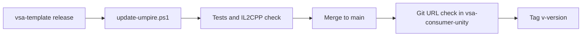

# vsa-unity

This repository is the Unity project of the UPM package `com.umpire.unity`: the Umpire framework (VSA pack) for Unity 6000.6.
The package is embedded in `Packages/com.umpire.unity/`. The project runs the Unity tests of the package and an IL2CPP player check of a sample module.

## Install the package

Add the git URL to `Packages/manifest.json`, with the tag of a release:

```json
"com.umpire.unity": "https://github.com/MgCohen/vsa-unity.git?path=/Packages/com.umpire.unity#v0.1.0-preview.27"
```

Each release has a tag `v<version>`, the version in `package.json`. To use a later release, change the tag in the URL.

For offline or patched use, copy `Packages/com.umpire.unity/` into the `Packages/` folder of the consumer project. The package documentation is in [`Packages/com.umpire.unity/README.md`](Packages/com.umpire.unity/README.md).

## Repository layout

| Path | Contains |
|---|---|
| `Packages/com.umpire.unity/` | The package: runtime, editor scripts, tests |
| `Assets/TestSuite/` | The test suite: drives a running game from the `unity` CLI. It is a project folder for now, not a package. See its [README](Assets/TestSuite/README.md). |
| `Assets/Sample/` | A small module in one asmdef |
| `Assets/SampleApp/` | `SampleShell`, `SampleHost` and the `Check` view of the IL2CPP check |
| `Assets/VContainerSample/` | A VContainer scene that uses the two directions of `Umpire.Unity.VContainer` |
| `Assets/Editor/Il2cppCheck.cs` | Builds the IL2CPP player of the check |
| `update-umpire.ps1` | Copies the Umpire DLLs and analyzers of a template release into the package |

## Commands

| Command | Does |
|---|---|
| `./update-umpire.ps1 [-Version <version>]` | Copies the DLLs of a template release to the package (default: the newest release) |
| `./run-tests.ps1` | Runs the EditMode and PlayMode tests |
| `./il2cpp-check.ps1` | Builds and runs the IL2CPP player |
| `dotnet test Assets/TestSuite/Client~/Tests` | Runs the tests of the status checker |

`update-umpire.ps1` downloads `umpire-<version>.zip` from the vsa-template release. It needs no token and no .NET SDK. It checks the SHA-256 value of each file in `manifest.json`.

## Release



1. On a new branch, run `./update-umpire.ps1`. It writes the Umpire version to the first line of the package README.
2. Change `version` in `Packages/com.umpire.unity/package.json`, for example `0.1.0-preview.28`.
3. Run `./run-tests.ps1` and `./il2cpp-check.ps1`.
4. Open a PR and merge it to `main`.
5. In vsa-consumer-unity, install the package from the git URL at the merge commit. Compile, run the engine and play the dice sample (#1).
6. Tag the merge commit `v<version>` and push the tag.

The workflow `.github/workflows/latest-tag.yml` moves the tag `latest` to each commit of `main`, but GitHub Actions are off for this repository. Use the version tags.

## The IL2CPP check

`il2cpp-check.ps1` builds a Windows IL2CPP player with managed stripping Minimal, and runs it. The player starts the app through `SampleShell` (a `Shell<Vsa<SampleHost>>`) and writes `CHECK` lines to its log.

| Line | Shows |
|---|---|
| `shell`, `presenter-dispatch` | `SampleShell` owns the app, and `UnityHost` adds the dispatch |
| `modules`, `typeArguments` | `SampleHost` gives the one-asmdef module |
| `request`, `presenter-event` | A request from a thread pool thread; the event runs on the main thread |
| `struct-argument` | Handlers closed over struct type arguments |
| `stopped` | The quit destroys the shell, and `OnStop` runs |

The check runs on a dev machine only. It needs the Windows IL2CPP module of Unity 6000.6.6f1.

## Open questions

- Stable versions: `latest` has no pinned versions and no test gate. When do consumers need version tags?
- Unity CI: a Unity license in GitHub Actions needs a license secret.
