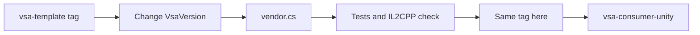

# vsa-unity

This repository is the Unity project of the UPM package `com.vsa.core`: the VSA core for Unity 6000.6.
The package is embedded in `Packages/com.vsa.core/`. The project runs the Unity tests of the package and an IL2CPP player check of a sample module.

## Install the package

Add the git URL to `Packages/manifest.json` of the consumer project. The tag is the VSA version.

```json
"com.vsa.core": "https://github.com/MgCohen/vsa-unity.git?path=/Packages/com.vsa.core#v0.1.0-preview.24"
```

For offline or patched use, copy `Packages/com.vsa.core/` into the `Packages/` folder of the consumer project. The package documentation is in [`Packages/com.vsa.core/README.md`](Packages/com.vsa.core/README.md).

## Repository layout

| Path | Contains |
|---|---|
| `Packages/com.vsa.core/` | The package: runtime, editor scripts, tests |
| `Assets/Sample/` | A small module in one asmdef |
| `Assets/SampleApp/` | `SampleApp` and the `Check` view of the IL2CPP check |
| `Assets/Editor/Il2cppCheck.cs` | Builds the IL2CPP player of the check |
| `Vendor/VsaVendor.csproj` | The VSA version of the package |
| `vendor.cs` | Copies the VSA DLLs into the package |

## Commands

| Command | Does |
|---|---|
| `dotnet run --file vendor.cs` | Copies the DLLs of `VsaVersion` to `Runtime/Plugins/` |
| `./run-tests.ps1` | Runs the EditMode and PlayMode tests |
| `./il2cpp-check.ps1` | Builds and runs the IL2CPP player |

`vendor.cs` reads GitHub Packages, so set `GITHUB_TOKEN` first, for example `$env:GITHUB_TOKEN = gh auth token`.

## Release



1. Write the VSA version in `Vendor/VsaVendor.csproj` (`VsaVersion`).
2. Run `dotnet run --file vendor.cs`. It also writes the version to `package.json`.
3. Run `./run-tests.ps1` and `./il2cpp-check.ps1`.
4. Commit, then add the tag `v<version>`.

## The IL2CPP check

`il2cpp-check.ps1` builds a Windows IL2CPP player with managed stripping High, and runs it. The player starts `SampleApp` through `VsaHost` and writes `CHECK` lines to its log.

| Line | Shows |
|---|---|
| `app`, `host` | The app scan finds `SampleApp`, the host scan finds the Unity host |
| `modules`, `typeArguments` | The module scan finds the one-asmdef module |
| `request`, `presenter-event` | A request from a thread pool thread; the event runs on the main thread |
| `struct-argument` | Handlers closed over struct type arguments |
| `stopped on quit` | `Application.quitting` stops the app |

The check runs on a dev machine only. It needs the Windows IL2CPP module of Unity 6000.6.6f1.

## Open questions

- Unity CI: a Unity license in GitHub Actions needs a license secret.
- Analyzers: VSA.Analyzers for Unity must build against Roslyn 4.10. Add the DLL to `Runtime/` after that build is published.
