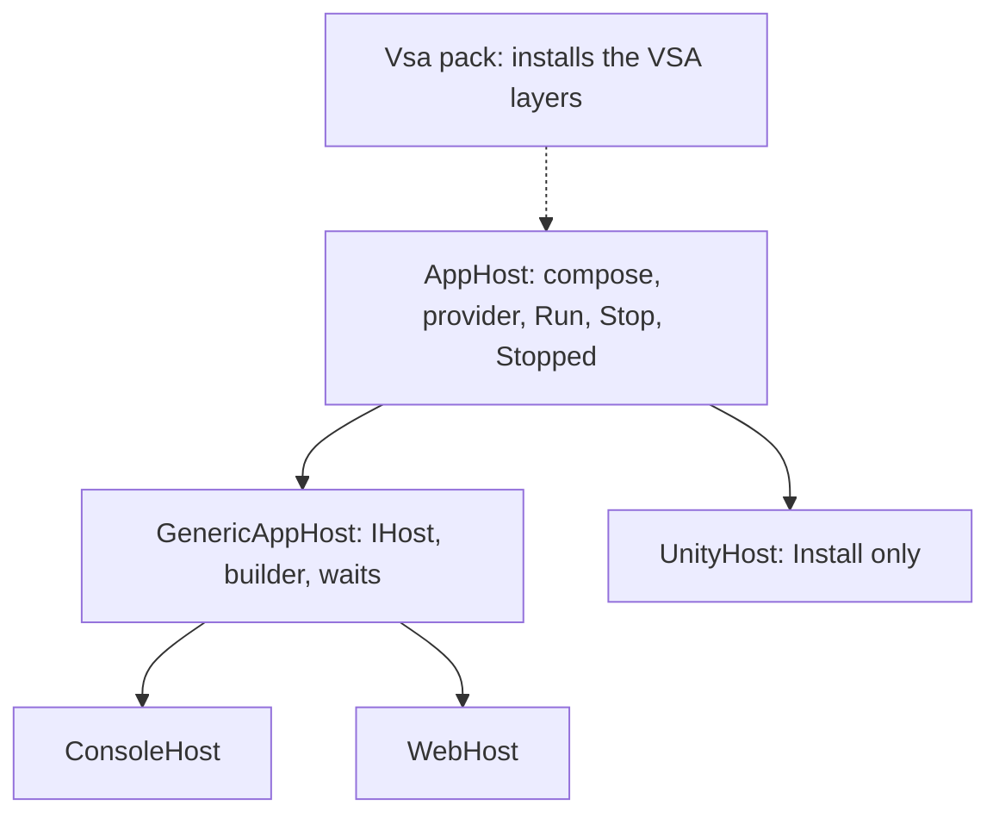

# Proposal: Umpire changes for a smaller Unity host

The Unity host has three parts that do not work for Unity. Each one comes from Umpire's `AppHost`, which assumes a .NET Generic Host that runs and waits. Four changes in `vsa-template` remove them. With all four, the Unity host is one `Install` method. The base: `vsa-template` `main` 5160ff1, packages `0.2.0-preview.1`.

## The Unity host now

```csharp
public class UnityVsaHost : VsaHost {
    protected override IHostApplicationBuilder CreateBuilder(string[] args) =>      // problem 1
        Host.CreateEmptyApplicationBuilder(new HostApplicationBuilderSettings {
            Args = args,
            ContentRootPath = Application.persistentDataPath,
        });

    protected override void Install(IServiceCollection services, AppTypes types) {
        base.Install(services, types);
        services.AddLogging(logging => logging.AddProvider(new UnityLogProvider()));
        services.AddSingleton<LivePresenters.Dispatch>(async work => {             // problem 4
            await Awaitable.MainThreadAsync();
            await work();
        });
    }

    public override int Run() => 0;                                                  // problem 2

    public override void Stop() {                                                    // problem 3
        try { Built.StopAsync().GetAwaiter().GetResult(); } finally { Built.Dispose(); }
    }
}
```

| # | Part | Why Unity needs it now | Source in Umpire |
|---|---|---|---|
| 1 | `CreateBuilder`, content root | `AppHost.Create` always makes a .NET builder. Its file provider fails on the Editor base folder. | `AppHost.Create`, `CreateBuilder` |
| 2 | `Run => 0` | The default `Run` is `IHost.Run`, which blocks | `AppHost.Run` |
| 3 | `StopAsync` + `Dispose` | `OnStop` runs only from `ApplicationStopped` | `App.Run`, `AppHost.Stop` |
| 4 | Main thread `Dispatch` | Presenter events run on the thread that published them | `LivePresenters.Connect` |

## Proposed changes



### C1: App gets the stop from the host, not from IHost

`App.Run` registers `OnStop` on `IHostApplicationLifetime.ApplicationStopped`. A host that has no run loop must then call `StopAsync` only to raise that event.

| File | Change |
|---|---|
| `framework/Kernel/Hosting/AppHost.cs` | Add `public event Action Stopped` and `protected void OnStopped()` |
| `framework/Kernel/App/App.cs` | Register `Stopped` on `host.Stopped`, not on `ApplicationStopped` |
| Hosts on IHost | Forward `ApplicationStopped` to `OnStopped()` |

Removes from Unity: `StopAsync().GetAwaiter().GetResult()`. `Stop` becomes `Dispose` and `OnStopped()`.

### C2: AppHost composes a service provider, and the Generic Host is a subclass

`AppHost` holds two jobs: the composition root and the .NET Generic Host. Unity needs only the first.

| File | Change |
|---|---|
| `framework/Kernel/Hosting/AppHost.cs` | `Create`: `new ServiceCollection()`, `Compose`, `BuildServiceProvider`. `Run` returns 0. `Stop` disposes the provider and calls `OnStopped()`. |
| New `GenericAppHost : AppHost` | `CreateBuilder`, `Build`, `Built`, `Run` (waits), `Stop` (`StopApplication`). The code that is in `AppHost` now. |
| `App.Run` | Move the `OperationCanceledException` catch to `GenericAppHost.Run` |
| Package split | `Microsoft.Extensions.Hosting` goes to the package of `GenericAppHost`, not to `Umpire.Kernel` |

Removes from Unity: `CreateBuilder`, the content root, `Run => 0`, `Stop`. Unity also does not vendor the Hosting DLL tree (Hosting, file providers, JSON, environment and command-line configuration, console and EventLog loggers). Problem P3 of `Probe/RESULTS.md` and its EventLog failure go away. I did not count the DLLs that leave.

### C3: The pack installs the VSA layers, the host is the platform only

`Vsa<THost>` and `VsaHost` both mean "VSA". `VsaHost.Install` adds the layers, so each platform host must derive from `VsaHost`, and `Vsa<THost>` requires `THost : VsaHost`.

| File | Change |
|---|---|
| `framework/Kernel/App/Pack.cs` | Add `protected internal virtual void Install(IServiceCollection, AppTypes)` |
| `AppHost.Compose` | Call `app.Pack.Install(services, types)`, then `host.Install(services, types)` |
| `packs/Vsa/VsaPack.cs` | Move the four `Add...` calls of `VsaHost.Install` here. Constraint: `THost : AppHost` |
| `packs/Vsa/Kernel/Composition/VsaHost.cs` | Becomes the generic platform host, or goes |

Removes from Unity: `base.Install` and the `Umpire.Vsa.Composition` base class. The Unity host does not know VSA. It also fixes P1: an app that names `Vsa<…>` references `Umpire.Vsa` itself.

### C4: LivePresenters uses the SynchronizationContext of Connect

`LivePresenters.Connect` runs when a view resolves its presenter, usually on the UI thread. If no `Dispatch` is registered, it can post each event to `SynchronizationContext.Current` of that moment. Unity sets `UnitySynchronizationContext` on the main thread.

| File | Change |
|---|---|
| `packs/Vsa/Kernel/Presenters/LivePresenters.cs` | In `Connect`, if `dispatch` is null and a context exists, dispatch through `context.Post` |

Removes from Unity: the `Dispatch` registration. Check in `vsa-template`: a Blazor view has its own synchronization context. Confirm that a post to it is correct for the web views.

## The Unity host after C1 to C4

```csharp
public sealed class UnityHost : AppHost {
    protected override void Install(IServiceCollection services, AppTypes types) =>
        services.AddLogging(logging => logging.AddProvider(new UnityLogProvider()));
}

public sealed class VsaShell : Shell<Vsa<UnityHost>> { }
```

## Order and size

| Change | Size | Gain for Unity | Risk for other hosts |
|---|---|---|---|
| C1 | Small | `Stop` loses `StopAsync` | Low |
| C4 | Small | No `Dispatch` line | Web views: confirm |
| C3 | Medium | Host does not know VSA, P1 fixed | Constraint change on `Vsa<THost>` |
| C2 | Large | No builder, no content root, no Hosting DLLs | Console and web hosts move to `GenericAppHost` |

C1 and C4 are independent. C2 needs C1. C3 is independent of the others.

## Non-goals

- No Unity code in `vsa-template`. Reason: `vsa-unity` owns the Unity parts, and `docs/unity.md` says so.
- No change to the logging. Reason: `UnityLogProvider` is a real Unity part, and a host adds it in `Install`.

## Open questions

- C2: one package for `GenericAppHost`, or does it stay in `Umpire.Vsa.Composition`?
- C3: does `VsaHost` stay as a name for the generic platform host, or does it go?
- C4: is the context of `Connect` the correct one for each web view?
